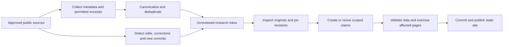

# Research catalog roadmap

Status: implemented in 2.0.0. This document preserves the accepted design; see `README.md` for operation and exercised verification. Research coverage remains selected and version-scoped, with explicit gaps—not an exhaustive inventory or a claim of independent binary reproduction.

## Direction

Build a versioned anti-cheat research reference, not a collection of bypass headlines or a general security-news feed. Keep GitHub Pages, static output, Git-backed structured content and a single-maintainer workflow. The blog explains investigations; it is not the underlying database.

The unit of knowledge should be a **scoped, attributable claim**. A repository, paper or forum thread is a source, not a truth verdict. The EAC Linux correction demonstrates why: an artifact can be valuable, partially recovered, externally disputed and not independently reproduced at the same time.

"Every weakness, leak and reversed detail" is a discovery ambition, not a completeness claim. Closed server internals, inaccessible threads, unpublished work and unknown builds cannot honestly be cataloged as known facts. Publish the coverage boundary and missing evidence instead.

## 1. Knowledge model

Evolve the existing records without maintaining a second parallel catalog. Migrate existing citations and relationships into these entities, retain stable page URLs, and version exported contracts when their shape changes.

| Entity | Required information | Why it exists |
|---|---|---|
| System / integration | Vendor, product, game integration, platform, lifecycle, documented boundaries | A product family is not one immutable deployment |
| Component | Driver, service, library, launcher, server boundary or firmware component; documented responsibilities | Do not assign every behavior to a kernel driver |
| Mechanism | Canonical behavior or interface, with build-specific claims and linked implementation evidence | Keep a general technique distinct from a claim that a vendor actually implements it |
| Sample / build | Filename, platform, version, source-reported hash, independently computed hash if available, provenance, acquisition date and source | A filename, certificate or version string alone is not identity |
| Source / revision | Original URL, publication and access dates, author attribution without profile links, repository commit or permitted snapshot digest, access status and rights | Claims must remain interpretable when the upstream page changes |
| Claim | One assertion, component/build scope, exact source locator, observation versus inference, supporting and contradicting sources, limits, review activity and claim state | Contradictions must attach to the specific assertion, not disappear inside an article |
| Finding | Root cause, trust boundary, prerequisites, reported impact, affected/fixed build evidence, CVE/advisory links and disclosure history | A weakness must not automatically become a current bypass claim |
| Investigation / project | Question, tools and versions, input identity, recovered artifacts, reported validation contract, unresolved functions, independent checks and criticisms | Function counts and screenshots do not prove whole-program equivalence |
| Correction / event | What changed, which claim/revision it affects, reason, evidence, date and resolution status | Corrections and superseded claims remain discoverable |

### Separate three axes

- **Provenance:** vendor documentation, research publication, source repository, community report, public disclosure or unverified provenance.
- **Review activity:** collected, source inspected, artifact inspected, behavior reproduced. Reproduction must identify who performed it and its bounded contract.
- **Claim state:** asserted, corroborated, disputed, refuted or superseded. Missing version applicability remains explicitly unknown.

Do not use a single green badge, star count or numeric confidence score to collapse these axes. "Source reviewed" is not "verified correct". One source mirrored on several sites is still one source.

### Minimum claim contract

Every technical assertion needs a stable ID, plain-language assertion, linked system/component, applicable platform/build or explicit unknown scope, original source/revision, a source locator (section, function RVA, source line or timestamp), evidence description, limitations, review date, supporting/contradicting relationships and a claim state. Address-bearing observations must identify the address space and image base when relevant. Preserve the distinction between a source-reported hash and a hash computed by this project.

## 2. Depth required for each system

Use one consistent dossier outline. Each cell is documented, partially documented or unknown, with evidence links; a missing cell is not evidence that a feature is absent.

1. **Deployment and lifecycle:** launcher, installation, boot/game/session start, update delivery, shutdown, game-specific settings and supported platforms.
2. **Component inventory:** drivers, services, libraries and remote boundaries; filenames, signers, versions, hashes and provenance where lawfully available.
3. **Interfaces and trust boundaries:** device objects, documented IOCTL or IPC responsibilities, caller authorization, client/server authority and boundary assumptions.
4. **Observed mechanisms:** process/handle callbacks, image loading, integrity checks, telemetry, enforcement, boot trust, attestation and virtualization-related observations. Separate vendor descriptions from sample-specific recovered behavior.
5. **Code protection and recovery:** protector attribution, VM/function inventory, recovered versus unresolved paths, toolchain, compiler effects and validation scope. A devirtualized count is not a correctness percentage.
6. **Publicly disclosed weaknesses and incidents:** mechanism/root cause, environment and prerequisite scope, impact, mitigation evidence, affected/fixed versions and open disputes. No unsupported "works today" labels.
7. **Research trail:** papers, repositories, forum claims, public status posts, corrections and provenance relationships. Specific posts may be cited; personal profile directories remain out of scope.
8. **History and gaps:** versioned changes, stale claims, unresolved questions, inaccessible sources and work needed to fill each gap.

For every mechanism, use a technical worksheet: trigger and lifecycle, execution context, inputs and outputs, inspected decision conditions, protected object, documented OS primitives versus custom logic, dependencies and trust assumptions, evidence/function locators, tested cases, counterexamples and unknowns. Track callbacks, IPC, memory operations, integrity checks and telemetry at this granularity rather than writing one generic paragraph about a driver. Use CWE or other established taxonomies only where a supported mapping exists.

EAC and Ironshield are the primary deep-dive pilots. The same dossier and worksheet contracts now cover BattlEye, Vanguard, FACEIT, RICOCHET, Javelin and ACE. Per-system questions expose the remaining evidence backlog; a filled outline does not establish complete research.

## 3. Discovery and maintenance pipeline

### Collect broadly; promote narrowly

- Maintain a source registry with acquisition method, product/topic scope, access status, polling policy and canonical URL. Track publishers, selected repository releases/commits/issues, vendor advisories and relevant public forum threads.
- Preserve discovered items in a durable registry. The former ten-items-per-feed snapshot has been replaced; later polling must not erase older discoveries or manual triage decisions.
- Canonicalize tracking URLs; connect mirrors, reposts and forks to the original. Keep source independence separate from URL count. Rank anti-cheat-specific items above unrelated publisher posts.
- A blocked forum remains an inaccessible lead. Do not manufacture a summary from its title, silently drop failures or bypass access controls. Authorized manual imports can provide reviewed text later.
- Prefer publisher RSS/Atom and official GitHub/vendor endpoints. Social-post acquisition needs an authorized API, a permitted public retrieval or an imported specific-post URL; unofficial mirrors are fallible transports, not guaranteed complete archives. Preserve which transport was used and never treat two mirrors as independent testimony.
- Backfill permitted publisher archives, sitemaps, category indexes, repository histories and already-known public disclosures before relying on incremental feeds. Track which source/date ranges were inspected and which remain unreviewed; a latest-items feed cannot stand in for a deep historical catalog.
- Separate the public, explicitly unreviewed discovery feed from the reviewed catalog. New feed items and repository commits do not automatically change claim states, reviewed commits or remediation conclusions.
- AI may propose tags, relationships, summaries and contradiction candidates, but every factual sentence needs an inspected source locator. It must not certify its own reverse engineering or turn tests it generated into independent corroboration.
- Run daily metadata discovery and a weekly focused maintenance digest, bounded by each source's approved scope and polling interval.
- Keep collection in GitHub Actions. Fetch data only: never execute newly discovered repository code, forum attachments or driver samples in a token-bearing publishing job. Any model credentials belong in Actions secrets, never browser JavaScript.

### One-maintainer operating loop

1. Open the generated inbox, prioritized by corrections, disputes, vendor fixes, upstream drift and then new research.
2. Inspect original material; update a claim rather than creating a duplicate article for every repost.
3. Review the proposed source/claim diff, including removed evidence and altered version applicability.
4. Run structural checks and smoke the affected dossier, search result and exports.
5. Commit once; Actions deploys. Keep a weekly summary of what was added, corrected, superseded or still blocked.

No additional contributor is required. Scheduled retrieval can run unattended; deep analysis requires an assistant run or separately configured analysis workflow. A static site does not perform new independent research by itself.

## 4. Feature priorities and acceptance

| Priority | Deliverable | Acceptance |
|---|---|---|
| P0 | Atomic claims, immutable source revisions and contradiction links | One function-level criticism can be linked without labeling unrelated results false; original and later revisions remain distinguishable |
| P0 | Build/sample identities and applicability | A historical finding cannot be presented as affecting an unexamined current build; reported and computed hashes are distinguishable |
| P0 | Corrections and validation ledger | Every "reproduced" statement identifies an execution record and contract; a repair commit cannot silently close a dispute |
| P0 | Durable discovery inbox and triage | Previously collected research survives feed rotation; blocked sources and unresolved items remain visible; duplicate mirrors do not inflate corroboration |
| P1 | Compact search-first catalog | Search by product, driver, hash, CVE, mechanism, function and source; URL-shareable filters; accessible keyboard operation; explicit empty states |
| P1 | Consistent system dossiers | Every system exposes the same component/research outline and visible gaps, without inventing missing architecture |
| P1 | Source and version diffs | Show what changed and which claims need re-review, not just a new commit SHA or star count |
| P1 | Correction/update RSS and saved queries | Readers can subscribe to changes; bookmarks/watchlists work locally without accounts and can be exported |
| P2 | Version-scoped comparison views | Compare documented mechanisms/builds, displaying unknowns rather than ranking anti-cheat strength |
| P2 | Evidence-backed relationship explorer | Draw only documented edges, each opening its supporting source; retain a table alternative |
| P2 | Static full-text indexing | Introduce a build-generated index such as Pagefind when the catalog outgrows client-side card filtering; no search backend required |
| P2 | Reproducibility workspace | Record authorized lab configuration, tool versions, expected/observed behavior and bounded negative results, isolated from collection/deployment |

Avoid accounts, a discussion forum, a public arbitrary-URL crawler, exploit hosting and a graph-first homepage. They add operational burden without improving the evidence model.

## 5. Simplify the UI

Recommendation: **yes—keep the visual identity, make the application quieter and denser.** Dark graphite and a restrained accent can stay; the catalog should behave like a reference tool rather than a launch page.

- Four primary destinations: **Catalog, Systems, Research, Updates**. Place methodology, coverage, data exports and publishing under secondary navigation. Projects become a Research filter; editorial notes remain identifiable as notes.
- Make the landing view a search box, useful filters, a compact record table and recent substantive corrections. Remove the oversized hero, repeated project/note lists and vanity counters from the reading path.
- Default result columns: item, system/component, topic/type, evidence/claim state, applicable build and last review. Put star counts and repository trivia inside project details, not beside research-quality signals.
- A system dossier starts with a short scope statement and component inventory. Use predictable sections: Overview, Components, Mechanisms, Findings, Research and History. Preserve stable deep links and an accessible outline instead of loading every detail into a giant card.
- At the top of a claim or project, show what is asserted, which build it concerns, who reported it, whether it is disputed and what this catalog actually checked. Keep full caveats available next to the evidence, not hidden in a footer.
- Use readable body type and monospace only for identifiers/code. Support adequate contrast, keyboard focus, reduced motion and a light theme. On mobile, collapse filters and outlines; wide tables scroll within their own region.
- Do not replace sourced architecture with decorative arrows. A component map is useful only when its edges have evidence.

UI acceptance: a reader can find a named driver, see its scoped responsibilities, distinguish a reported weakness from a reproduced result, and open the original source without scanning multiple promotional sections. Test common phone, tablet and desktop widths, real filter interactions and downloads—not screenshots alone.

## 6. Delivery order (implemented)

1. **Evidence migration:** define the claim/source/build/correction contracts, migrate the existing 52 records and 9 notes, remove obsolete fields only after all callers/exports move, and seed the EAC dispute as the first contradiction case.
2. **Deep dossier pilot:** complete the EAC and Ironshield outline using inspected public evidence. Publish specific gaps and revision limits; do not equate a filled paragraph with completed research.
3. **Maintenance automation:** durable inbox, canonicalization, source-change detection, correction priority and GitHub-native reviewable updates. Retain the existing Pages deployment route.
4. **UI simplification:** compact catalog and four-destination navigation, uniform dossiers and visible evidence/claim states. Remove duplicated content after the new views work end to end.
5. **Coverage expansion:** repeat the pilot standard across the remaining systems. Use static search, comparisons and subscriptions without weakening the underlying evidence contract.

Each stage must ship complete behavior, migrated callers/exports, structural validation and browser smoke proof. Do not publish a placeholder "deep dossier" with guessed mechanisms.

## Publication and rights

Catalog publicly disclosed research, root causes and provenance. A purported leak can have a metadata record stating authenticity, public source and uncertainty; public availability does not authorize mirroring stolen source, proprietary dumps, credentials, personal data or undisclosed vulnerabilities. Do not turn a research reference into a live bypass service. Preserve vendor disclosure and remediation uncertainty. Choose explicit licenses for this project's own code and original content before claiming redistribution rights; third-party material retains its own terms.
